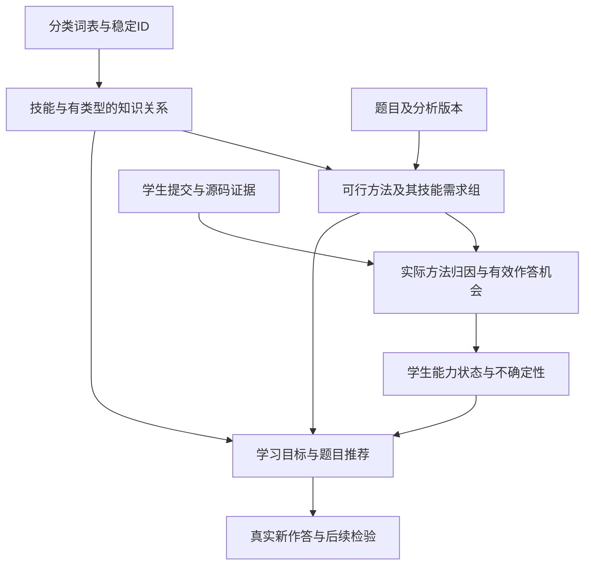

# 知识图谱研究：从题目标签到学习基础、解法证据与个性化训练

日期：2026-10-22。状态：研究建议，供负责人和教师讨论；不是已批准设计或已实现功能。

本轮阅读当前项目长期记录、根目录作者笔记及只读目录三份作者笔记，核对分类词表、分析、提交、旧画像与推荐、独立评分内核及采集契约。仅新增研究资料与维护项目记录，不修改作者笔记、应用代码、知识树或学习数据库，不调用模型，不提交推送。

## 1. 研究结论

建议以“保留分类树 + 增加有类型的知识关系 + 按具体解法建立题目需求 + 保留学生实际作答证据”为目标，分阶段建设。

第一阶段可以先交付一个经审核的先修子图，用于找基础缺口和选择下一学习目标；随后接入解法与提交归因，才真正支撑细粒度画像。数据驱动的图神经网络等模型作为后续实验候选。

核心判断：

1. 老师所说“前驱/后继”很可能是知识点之间的学习先修关系，仍需用具体例子确认，不能把我们的解释写成老师已经认可的定义。
2. 分类树回答“它属于什么”；先修关系回答“为学习这个目标，哪些基础需要先准备”；题目需求回答“用这条解法完成这道题，要用到哪些能力”。三者不能共用一类边。
3. 图谱首先帮助推荐找到“学得动的下一步”和诊断定位“可能缺的基础”。不能沿图连边机械加分、扣分，或把前驱分数传到后继。
4. 本项目最值得做的研究问题是：**相同作答证据下，显式先修关系能否改善训练选择；相同题目下，方法级归因能否减少画像错归因。**
5. SQLite足以表达这一阶段的节点、关系与需求组；有图的数据结构不要求使用图数据库。存储技术本身不构成教学效果。

## 2. 当前项目的已核验事实

| 范围 | 当前事实 | 对新图谱的意义 |
| --- | --- | --- |
| 知识词表 | `data/knowledge_taxonomy.json`版本2026.10.1，共377节点：10 L1 / 158 L2 / 209 L3；337叶子 | 可以沿用稳定ID和分域，不能从零重造一份互不相认的目录 |
| 节点字段 | id、name、level、parent_id、summary，以及语法节点的intro_rating；schema禁止额外字段 | 没有当前生效的先修字段、边或关系审核 |
| 标签用途 | L1只聚合，L2/L3可标题；同一题允许多种可行方法的标签并存 | 可用标签的并集不等于一种方法的共同需求 |
| v8分析 | `assessment_meta.solution_record.methods`保存方法名、方法知识点、时间/空间复杂度 | 已有方法级材料可作为迁移输入；还没有规范的方法标识、条件需求组与提交归因契约 |
| 提交快照 | `app/api/submissions.py`复制当前已审核分析的标签并集与难度 | 尚未识别学生实际采用的方法；不能直接把并集用于新画像 |
| 旧推荐 | `app/services/recommend.py`按标签薄弱度与难度适配排序 | 没有评估目标先修是否准备好，也没有替代方法语义 |
| 旧学习路径 | `learning_path`沿`taxonomy.ancestors`输出目录链 | 属于分类路径，不能称为学习先修路径 |
| 独立IRT | `rating.py`及预览接口处理一维有效机会 | 尚未解决多技能联合需求、实际方法、同题机会分组或11项聚合 |
| 采集 | 独立采集库保存外部提交、题目标识、源码及其可见状态等 | 还需题目规范化、词表映射和证据处理；采集成功不等于形成画像证据 |

历史文档的冲突要特别说明：

- `docs/knowledge-standard.md`仍写2026.09.9 / 345节点；它的“不是先修图”描述与当前结构相符，但节点数不是当前值。
- 更早记录曾有带前置关系的知识体系；随后纯标签词表重做时移除了相关字段和推荐逻辑。不能据旧文档宣布已经具备先修图。
- 旧画像和推荐仅用于了解当前缺口，不作为新设计的权威模型。
- 本轮没有查询正式数据库，也没有重新验收四平台真实采集；不沿用历史“零提交”等计数作为当前事实。

作者笔记提供的需求线索：

- 10.17的问题包括高难证据、数量与难度、失败记录、多解法归因、练习条件与不确定性。
- 10.21强调先获取真实、可恢复的提交数据，为后续研究建立基础。
- 原笔记中的评分假设和实验属于对应阶段的探索；它们不自动决定先修图的语义，也不证明知识关系或画像已被验证。

## 3. 怎样理解“前驱”和“后继”

### 3.1 先定义箭头的意思

约定`A → B`为“A是学习B的某种前置基础”。A是B的直接前驱，B是A的直接后继。

例如，在“理解并自行实现矩阵快速幂”这一目标下：

```text
矩阵乘法 ─┐
          ├─ 必需基础 → 矩阵快速幂
快速幂 ───┘
```

这里是两项都需要，不能解释成“任选一个”。这些是研究示例，尚未登记为正式关系；“矩阵乘法/矩阵快速幂”也尚未成为当前词表中的独立ID。

若`A → B → C`，A可称为C的间接前置，但界面和数据应区分直接关系与传递推导。优先维护少量有理由的直接关系，避免给每对祖孙节点复制一条边。

“每个知识点有前驱/后继”不应机械理解为每个点的入度、出度都至少为1。起点可以没有前驱，当前最深目标可以没有后继，独立主题也可能暂时没有经确认的边。强行连边会制造错误或环。

只保存一个方向的关系即可，前驱列表和后继列表互相查询得到，避免两份数据维护出矛盾。

### 3.2 至少区分这些关系

| 关系 | 回答的问题 | 示例 | 可以据此限制推荐吗 |
| --- | --- | --- | --- |
| 属于/分类 | 这个主题放在哪个目录 | 树状数组属于数据结构 | 不可以 |
| 必需基础 | 指定目标和路线下，不具备A通常无法独立完成B的学习任务 | 标准矩阵快速幂实现需要矩阵乘法 | 可以影响准备度，未知先诊断 |
| 建议先学 | A通常有助于理解B，但存在其他教学路线 | 先学KMP有助于理解AC自动机的失配思想 | 软排序，不作为绝对门槛 |
| 特定实现依赖 | 某个方法或实现方案用到了A | 二叉堆用于二叉堆优化Dijkstra | 仅限制对应方案 |
| 相关/对比 | 适合比较、迁移或辨析 | 前缀和与差分 | 不能据此加减能力分 |

“可替代”通常更适合挂在**题目的可行解法**上。例如“树状数组解法或线段树解法都能通过某道题”，不表示树状数组和线段树在所有任务上可互换。

不必第一版实现所有关系的算法效果，但至少应避免把它们全部存成一个无类型的prerequisite。

### 3.3 硬前置也需要上下文

“必须先会”不是对所有学生、所有实现、所有学习深度都成立的自然法则，应限定为：

> 在这个明确的学习目标、教学深度和可选路线下，要独立完成相应任务所需的基础。

反例：

- 二叉堆不是“最短路”的普遍前置。朴素Dijkstra不要求堆；堆优化又可使用不同维护结构。[7]
- “树形DP先学递归”是常见路线，但可以用显式遍历顺序做迭代实现；不能把递归写成所有树形DP方法的不可替代基础。
- 会用STL优先队列、会手写二叉堆、理解堆的不变量是不同深度。画像不能因代码出现`priority_queue`就认定三者都掌握。
- KMP对AC自动机有解释价值；OI Wiki用它类比fail思想，但这不能证明“必须先独立做出KMP题才能学习AC自动机”。[6]

因此每条边应有适用范围，而不是靠一个0到1的权重掩盖语义歧义。

### 3.4 环怎样处理

- 同一已选定路线的必需基础投影应为DAG，便于找基础、排学习顺序与诊断。
- 不对整张异构图要求无环：相关、对比、替代关系可以双向。
- 出现“互为必需基础”时，先检查概念粒度、目标深度和边类型；必要时表达为同一学习单元，不任意删边以通过校验。
- 不把不同教学路线的边无条件合并后当作同一组必需条件。含AND/OR的路线应按完整需求组求可行性，单纯拓扑排序不足以完成推荐。

## 4. 哪些内容适合作为节点

当前目录主要按“能否给一道题打标签”设计，适合检索与分域统计，但不完全等于可独立诊断的能力集合。

现场例子：

- `graph.shortest-path`只有“最短路”这个宽泛节点，未细分朴素Dijkstra、堆优化Dijkstra等。
- `ds.segment-tree.basic`的介绍覆盖单点修改、区间查询、懒标记和下传。做出单点修改题，不足以证明掌握懒标记。
- `math.linear-algebra.matrix`同时介绍矩阵乘法、快速幂、高斯消元等用途，不能据一道矩阵快速幂题认定全部矩阵技能。
- `search.dfs`与`graph.dfs`分别描述一般状态搜索和图遍历；有共同核心，但不能按同名术语自动合并或把同一次遍历算成两份独立证据。

建议保持三种角色：

1. **分类标签**：沿用当前词表，便于已有分析、筛选和10个L1摘要兼容。
2. **可诊断技能**：只在确有题目与诊断需求时补充，如“理解矩阵乘法”“单点修改与区间求和”“懒标记合成”。须有能观察到的完成标准。
3. **学习单元/具体方法**：允许组合多个技能，如“矩阵快速幂入门”“区间加、单点查的差分+树状数组方法”。

标签与技能允许显式映射，一对多不表示学生一次掌握了所有映射技能。初期可先用粒度合适的L2/L3作为技能，再对少量有证据的宽标签补细分。

不全量推翻377节点，不默认建立L4，不为凑规模加入“工具、章节名、无对应题目”的空壳节点。新增粒度必须回答：它能区分哪两种学生？什么练习可以验证这种区分？

## 5. 可行方案比较

| 方案 | 建什么 | 对画像的帮助 | 对推荐的帮助 | 代价与限制 |
| --- | --- | --- | --- | --- |
| A：现有标签 + 经审核的先修图 | 沿用L2/L3，增加有类型、有范围的前置边 | 可提示待诊断基础；直接能力仍靠作答证据 | 推荐已具备基础的下一知识点、基础补练 | 最快形成闭环；宽标签和多解法错归因仍存在 |
| B：知识关系 + 方法需求 + 作答证据 | 在A之上补必要技能粒度、题目方法组、提交实际方法和证据状态 | 能区分实际使用与可替代方法，减少无依据全标签加分 | 目标、基础、可行解法、难度、诊断价值共同选题 | 更贴合本项目；需要少量高质量方法标注与版本契约 |
| C：人工图基础上的数据驱动模型 | 比较图结构知识追踪、关系学习、后续图神经网络等 | 可能捕捉技能关联与时序变化 | 学习排序或表现预测，检验人工图的增量价值 | 需多用户多样数据、严格验证；更难解释，不保证教学提升 |

**建议：以B为目标，先交付A的代表性子图，再补B的解法/证据闭环。C放到有真实数据和可靠对照之后。**

如果目前只是展示老师所说的前驱后继，A足够；如果目的是改善画像与个性化推荐，停在A会留下作者笔记已经指出的多解法归因问题。

一名选手的数万提交可以验证采集、个人重放和案例诊断，不等于已有足够独立学生样本可证明C的泛化效果。

## 6. 推荐方案的四层结构



### 6.1 静态知识结构

候选关系记录至少包含：

- 起点、终点、关系类型和适用路线/目标深度；
- 原因说明、参考来源和可反驳它的例子；
- proposed / reviewed / rejected等状态，以及审核者角色与版本；
- 创建、审核和废弃时间，关联词表/技能版本。

“AI认为0.95”属于机器自报，不能写成95%已被证实正确。来源、审核状态和未来由数据估计的可靠性分别记录。

人工确认与模型候选分开。LLM可列候选和帮助找反例，不能让它一次生成377节点的所有关系后直接参与正式限制。

### 6.2 题目—方法—技能需求

一题可以有多个通过当前约束的方法，各方法内可能需要多个技能：

```text
题目P
├─ 方法M1：技能A AND 技能B
└─ 方法M2：技能C AND 技能D

方法M1 OR 方法M2可完成P。
```

这是按方法扩展的题目—技能需求表，类似认知诊断使用的Q矩阵思路，但增加了可替代方法。[3][4]

应记录方法适用的数据范围、复杂度和证据。小数据能通过的搜索法不应因“不是预期DP法”而被判不存在；大数据必超时的方法也不能算可行替代。

**两种AND/OR需要分开：**

- 学习目标的基础需求：这条教学路线需要哪些基础；
- 解题方法的技能需求：这一种解法需要哪些技能。

有可替代基础时，用“组内AND、组间OR”的完整需求组表达，而不是把所有前置一股脑做AND。复杂情况超过这种表达时再扩展，不必初期实现任意布尔表达式。

当前v8方法审计记录可作为起点，但需要复核，尤其手工分析可能没有完整方法列表。不能认为已有审计JSON就完成了这层契约。

### 6.3 作答证据与实际方法

一条有效证据应能追溯：

- 用户、规范化题目、原提交ID和时间、题目/分析版本；
- 练习或比赛、已知辅助条件、结果与同题尝试分组；
- 实际方法：已确认、候选不确定、未识别；
- 使用的技能、角色（核心/辅助）、代码位置或其他可检查依据；
- 归因来源（人工/模型/规则）、审核状态、模型与图谱版本。

代码可提高归因能力，但“代码用了这个结构”不等于“学生理解了它”。缺源码时保留提交，可用于较粗统计；具体技能归因保持未知。已识别使用某方法也不是绝对排除隐藏的其他思路。

实际使用树状数组方法，就不能因为题目也可用线段树而给线段树同等成功证据。

AC可以支持多个共同必需技能，但它仍是一份联合观察，不应给每个技能复制一份完整、相互独立的“高难成功”。同样不能把题目整体难度d当作每个辅助技能自己的测试难度。

### 6.4 动态学生状态

静态图谱表达知识关系；每个学生的状态单独存，不复制一整棵个人知识树。

候选状态至少区分：

- 直接支持的能力和不确定性；
- 已确认、薄弱、待评估等证据状态；
- 有效独立题数、最近证据时间、辅助情况；
- 图结构提示的待检查缺口与支持它的推理链。

“不知道这个学生会不会”不能记成“这个学生不会”。“能够使用模板”也要与“能独立实现/迁移”区分。

原11个分值可以继续作为未来的展示候选，但它们是细粒度证据的摘要。总分或L1高分不能直接解锁该领域所有技能；画像聚合公式仍是后续独立问题。

独立一维IRT可以保留为评分候选。第一版可先对方法清楚、技能需求集中的题形成评分证据，联合题暂保留联合证据与诊断价值；要利用联合题更新多个能力分布，必须设计联合响应模型，不能简单重复调用一维内核。

## 7. 图谱怎样改善画像

### 7.1 先修图用于检查与补证据

若学生在可信条件下独立完成AC自动机题，而字典树没有直接证据，可以记录：

> 存在支持字典树相关能力的间接线索；可通过少量迁移题确认。

不能记录成“字典树满分”。模板、辅助、方法识别错误、技能深度差异都可能解释这种现象。

若字典树基础题连续失败，却在AC自动机题成功，也不立即判定矛盾或作弊。先检查题目版本、代码方法、辅助条件、作答时点和图边范围。

原则：**图结构先用于推荐与诊断；沿边传播能力只能在明确概率模型中作为软推断，保留不确定性与来源。**

### 7.2 联合失败不能机械归因

设一道题要求A AND B。只知道没做出，无法判断缺A、缺B还是两者都缺；也可能是实现错误。

最简单的无噪声逻辑例子：A、B四种掌握状态等可能，失败排除“都掌握”，剩下三种情况。因此失败后A仍可能已掌握，B也仍可能已掌握，而不是两项都记成0。

这只是逻辑反例，现实还含失误和辅助，不能拿这个等概率假设作为学生概率估计。

有用的下一步是挑能区分原因的题：只考A的已审核诊断题，或只考B的题，而非继续塞更难的A+B综合题。

### 7.3 学习图与能力相关不是一回事

“通常先学A再学B”不自动意味着“会B的人一定会A”，更不意味着“A失败应扣B分”。

学生历史中A、B经常一起通过，也可能来自统一课程安排、共同题型、学生总体能力或题目重复。相关与时间顺序不能直接证明必需先修。

## 8. 图谱怎样改善推荐

建议先回答“这次推荐要做什么”，再找题：

| 目的 | 何时需要 | 图谱怎样帮忙 |
| --- | --- | --- |
| 补基础 | 目标明确，但已验证的必需基础薄弱 | 找阻塞目标的最近基础，不把所有祖先都重新学一遍 |
| 学新点 | 至少一条路线的基础准备较好 | 从当前可学习边界选目标，避免同时引入多个未知核心技能 |
| 巩固迁移 | 基础题做得出，但新情境证据不足 | 换情境、约束或组合，检查是否只是记住模板 |
| 诊断 | 准备度未知、联合题失败原因不清 | 选能区分几种原因的题，减少误判 |

候选流程：

1. 确定用户目标与本轮目的；目标可由学生选择，也可提出建议。
2. 查目标的已审核基础需求组，找至少一条合理路线。
3. 必需基础已知薄弱则补练；未知则做诊断，不能无期限封锁。已有可信直接表现时允许跳过重复入门验证。
4. 在对应目标/路线下筛题，核对可行解法、题面版本、难度来源及辅助条件。
5. 排序同时考虑目标相关、难度适配、新技能负荷、信息价值、内容多样性和近期重复。
6. 给简短、可追溯的理由，观察新作答后调整。

例子：

> 你对快速幂已有较充分证据，但矩阵乘法尚未验证。先做这道小规模矩阵乘法诊断题；确认后进入矩阵快速幂。

另一个例子：

> 这道区间题上次采用了树状数组。若目标是线段树，本次需要线段树方法证据；重复AC不会自动补足。

练习平台通常不能禁止用户换解法。用户采用替代法仍然算题目通过，但可能尚未验证本次训练目标；未来可选要求说明思路、提交实际方法或匹配更适合区分目标的题。

可以把策略写成“基础准备度、目标相关、难度适配、诊断价值、冗余惩罚”的可解释组合，但本轮不设未经校准的最佳权重，也不把IRT预测50%成功题固定定义为最佳教学题。

如果使用掌握概率：AND准备度不能直接用平均数。乘积需要独立假设，最小值也只是瓶颈启发式；暂时缺联合模型时，可用明确的“已验证/薄弱/未知”规则，并记录限制。

目标知识点本身允许未掌握，否则系统永远只能推荐已经会的东西。准备度检查的是学习目标的基础和其他负荷。

“当前可学习边界”借鉴知识空间/学习空间的思想，但本方案不是完整实现ALEKS或所有知识空间公理。存在替代路线时，一个简单DAG也未必能完整表达所有可能知识状态。[1]

## 9. 三组候选子图与反例

这些是下一阶段供负责人和教师审阅的样例，不是已批准边表。

| 子图 | 候选内容 | 能验证的价值 | 必须包含的反例 |
| --- | --- | --- | --- |
| 区间维护 | 前缀和、差分、树状数组、线段树及特定操作需求 | 区分静态/动态、单点/区间；树状数组与线段树方法归因 | 做前缀和不代表会树状数组；树状数组不能替代所有线段树操作 |
| 字符串匹配 | 字典树、失配思想、BFS构建路线、AC自动机；KMP作解释辅助 | 先修与建议顺序区分，跨领域基础 | 会KMP不自动会AC；没有KMP直接证据不应永久禁止AC |
| 矩阵递推 | 矩阵乘法、快速幂、矩阵快速幂、线性递推建模 | 多基础AND、计算与建模分离 | 会数值快速幂不等于会矩阵乘法；会矩阵计算不等于会构造状态转移 |

额外保留“朴素Dijkstra不需要二叉堆”的否定案例，专门阻止把实现依赖误写成大类硬前置。

建议先选约20–40个代表性题目、约20–40个可解释技能/学习单元，规模按真实题目需求调整；初始数量只是建议预算，不是覆盖完成标准。至少同时包含AND、OR、未知、联合失败、辅助完成和跨站重复题。

每条硬关系必须回答：

1. 这里要达到什么能力深度？
2. 不具备起点，是否存在合理替代路线？
3. 有哪些题能验证基础，哪些题能验证目标？
4. 这条关系给用户带来的推荐差异是否合理？

## 10. 构建与维护方法

### 10.1 人工种子，机器辅助，数据修正

1. 从真实目标题和其方法反推必要技能，形成少量候选。
2. 查算法资料，明确“属于、必需、建议、特定实现”等语义。
3. 由熟悉竞赛教学的人独立评审边的方向、类型和适用范围，保留争议。
4. 校验ID、版本、重复、硬依赖环、需求组可满足性及覆盖缺口。
5. 用真人历史重放和小规模新诊断查反例；发现错误则保留旧版、发布新版本、重放派生结果。
6. 数据较丰富后再学习候选边或比较图模型，不能将高共现自动升级为已确认先修。

OI Wiki是内容结构和算法依据，不是已经验证的“学生先修关系金标准”。页面顺序、超链接和“可参考某算法”只能提供候选。

### 10.2 存储与接口候选

第一版可将关系和需求组保存在版本化JSON供人工审阅，运行时载入内存；需要审核和查询历史后落SQLite。不是必须先完成一套图编辑器。

正式存储可按职责考虑：

- 技能/学习单元及与原标签的映射；
- 有类型的知识关系与审核版本；
- 学习目标的基础需求组；
- 题目方法与方法技能需求；
- 提交归因和有效机会；
- 评分/诊断/推荐派生结果及其版本。

这是职责划分，尚未确定表结构。允许用关联表表达组内AND、组间OR，不用拼接自由文本让程序猜。

SQLite官方递归CTE支持层级和图查询；本项目规模下也可以内存邻接表遍历。[8] 使用Neo4j的理由应是已观察到的查询、协作或性能需要，而非“名字叫知识图谱”。

关系版本、题目分析版本、归因版本、模型版本分开。历史记录不能因为一次改边被静默覆盖。

原题标签、平台标签、项目技能各保留来源映射。跨平台同题须有可追溯的规范化映射，避免VJudge转引原OJ题被当成第二份独立成功。

### 10.3 界面职责

本轮不制作或改变前端。后续界面必须遵守`docs/design/FINAL_FRONTEND_TEMPLATE.md`。

现有知识树仍适合查目录；图谱的价值应能由“前置基础、可选路线、后续目标、推荐理由”体现，不应依赖用户操作377节点的大型力导向图。

可以后续讨论局部邻域查看，区分关系类型和证据状态；不擅自恢复已删除的知识树“设为学习目标/看推荐训练”按钮。页面入口与最终布局另行确认。

## 11. 怎样验证“有用”

### 11.1 结构正确与教学有效分开验收

| 层次 | 方法 | 能说明什么 | 不能说明什么 |
| --- | --- | --- | --- |
| 结构校验 | 引用/版本有效、无非法环、需求组可满足 | 图能被一致解释 | 边符合真实学习规律 |
| 专家审核 | 独立判断方向、类型、深度、替代法与反例 | 内容合理性与分歧 | 学生必然受益 |
| 方法归因 | 对源码和真实可行方法做人工标注，单列未知 | 是否减少全标签误归因 | 是否提高学习效果 |
| 历史预测 | 只用过去预测后续有效作答，比较log loss、Brier和校准 | 是否更准确描述后续表现 | 推荐导致进步 |
| 新训练试验 | 对照诊断、训练和迁移测验，观察后测与延迟表现 | 图谱策略的实际训练价值 | 自动推广到所有学生和主题 |

主要对照应能隔离不同改进：

- 保持相同题库、难度、归因证据与能力模型，对比“无先修信息”与“有先修信息”。
- 保持相同图谱和能力模型，对比“题目标签并集”与“实际方法归因”。
- 需要时加入仅难度匹配的简单基线，不以旧启发式作为唯一、弱化的对手。

不能一次同时换图、标签、难度公式和推荐算法，再把所有收益归功于图谱。

### 11.2 防止评估得到虚高结果

- 按时间切分，同一题的重复提交、跨平台同题和近似题族成组处理；不把同题后续AC泄漏到先前预测。
- 图边或参数若从数据学习，只使用训练期数据；手工图的制定也应记录是否见过测试案例。
- 新用户泛化需按用户留出；同一选手的随机提交切分不能证明对新学生有效。
- 不能把“未提交”当作失败，不能把最终AC清单当成预设独立测验的全成功记录。
- 同题WA→AC保留过程，但事先定义有效机会，不能每发提交独立加权。
- 模型识别不清时单列未知与覆盖率；不能只在容易识别的代码上汇报准确率。
- 先修缺口率等图内指标可检查规则遵守，不能单独证明真实推荐质量。
- 多学生时报告按学生/主题的不确定性，避免把数万相关提交当作数万独立受试者。
- 个体小样本先做可审计案例与重复测量，明确不能得出总体因果结论。

候选真正目标：完成新知识所需时间、独立解决迁移题的表现、延迟保持、诊断节省题数，以及用户能否理解推荐理由。即时AC率、点击率和图的节点数只作辅助观察。

## 12. 分阶段交付建议与未决问题

### 阶段一：定义与种子图

交付术语表、已有标签的粒度审计、三组候选子图、关系依据与反例、专家审核记录、基本结构校验。

此时允许用局部规则辅助解释，不宣称已具备完整画像或全域学习路径。

### 阶段二：方法与证据闭环

交付代表题的方法需求组、实际代码方法标注、同题/跨站去重与有效机会规则、可追溯能力/诊断记录。

把“会树状数组但尚未验证线段树”等作者关注的场景做成可复查案例。

### 阶段三：推荐与对照

在真实冻结数据上重放，随后做少量新诊断与训练任务；与无图和无方法归因对照。按证据决定是否扩图和更换模型。

### 阶段四：数据驱动研究

比较人工图、无图、数据候选图及GKT等模型；预测提高与教学提高分别报告。没有达到数据和评估条件时不提前上复杂模型。

仍需负责人/教师确认的关键点：

1. “前驱/后继”指教学先修、算法实现依赖，还是还包括专题迁移？可用“二叉堆是否是所有最短路前置”来区分。
2. 知识点掌握的深度是“能调用”“能独立实现”，还是“能建模并迁移”？可按节点定义而非全系统一个阈值。
3. 首版优先覆盖哪些实际训练目标；谁负责确认少量关键硬关系？
4. 用户允许/能够提供的作答辅助信息到什么程度；缺失时按未知处理。
5. 后续真实验证可获得多少学生、多少新测验机会？本轮不假设已有。

这些问题不阻止本轮给出方案；决定的是下一阶段的范围和关系强度。本轮没有把任何方案视为用户已批准。

## 13. 资料依据与查阅边界

本轮在线核对日期为2026-10-22。以下支持研究方向，不代表这些论文已经验证CodePowerPlus的算法竞赛场景。没有将摘要阅读写成全文复现。

1. **知识空间与学习空间**：Doignon, *Learning Spaces, and How to Build Them* (2014)，[出版页与摘要](https://doi.org/10.1007/978-3-319-07248-7_1)；[ALEKS官方Knowledge Space Theory说明](https://www.aleks.com/about_aleks/knowledge_space_theory)。核对知识状态集合和结构化自适应评估思想。ALEKS页面的产品表现/题量不能移植为本项目承诺。1990年基础论文[Introduction to knowledge spaces](https://doi.org/10.1037/0033-295X.97.2.201)仅核对书目信息。
2. **知识追踪**：Corbett & Anderson (1994)，[Knowledge tracing: Modeling the acquisition of procedural knowledge](https://doi.org/10.1007/BF01099821)。核对出版页与摘要；原任务即程序教学，根据规则掌握估计选择个性化练习，但任务粒度与竞赛题不同。
3. **认知诊断与联合技能**：de la Torre (2011)，[The Generalized DINA Model Framework](https://doi.org/10.1007/s11336-011-9207-7)。核对摘要，支持对多技能需求与非补偿式联合建模的讨论；未复现估参算法。
4. **多解法的直接相关研究**：de la Torre & Douglas (2008)，[Model Evaluation and Multiple Strategies in Cognitive Diagnosis](https://doi.org/10.1007/s11336-008-9063-2)。核对出版页与摘要；其明确扩展DINA以允许多种解题策略，为“方法级需求而非单一标签并集”提供已有研究背景，不证明可原样套到竞赛源码。
5. **后续数据驱动候选**：Piech等(2015)，[Deep Knowledge Tracing](https://arxiv.org/abs/1506.05908)，核对摘要；Nakagawa等GKT，[2019会议论文](https://doi.org/10.1145/3350546.3352513)核对Crossref元数据，[2021期刊扩展](https://doi.org/10.3233/WEB-210458)核对Crossref登记摘要。摘要支持图结构知识追踪的研究可行性，不支持把学到的关联直接视为因果先修，也不支持小样本必胜。
6. **算法内容与候选关系**：[OI Wiki：AC自动机](https://oi-wiki.org/string/ac-automaton/)。核对正文中Trie、fail、KMP类比、队列构建及不同统计优化；这些是构造候选教学关系和反例的依据。
7. **实现依赖反例**：[OI Wiki：最短路](https://oi-wiki.org/graph/shortest-path/)。核对正文中朴素Dijkstra、堆优化以及其他维护结构的区别，说明“堆→所有最短路”的硬边不成立。
8. **存储可行性**：[SQLite官方WITH/Recursive CTE说明](https://www.sqlite.org/lang_with.html)，重点核对§3.3图查询和DAG多父节点例子；支持SQLite表达和遍历图，不是本项目性能实测。

本地研究收据在`output/knowledge-graph-research-2026-10-22/`：来源URL、状态、响应摘要/哈希、页面提取文本及Crossref元数据。一次Google搜索超时、一个OpenDSA地址404，均未作为论据；改用出版页、Crossref及官方正文。

本轮的小型逻辑反例与一致性核验仅验证AND/OR及归因语义，未使用真实学生数据，不构成推荐收益或画像准确率实验。完整结果与文件保护核对另见同目录JSON。
